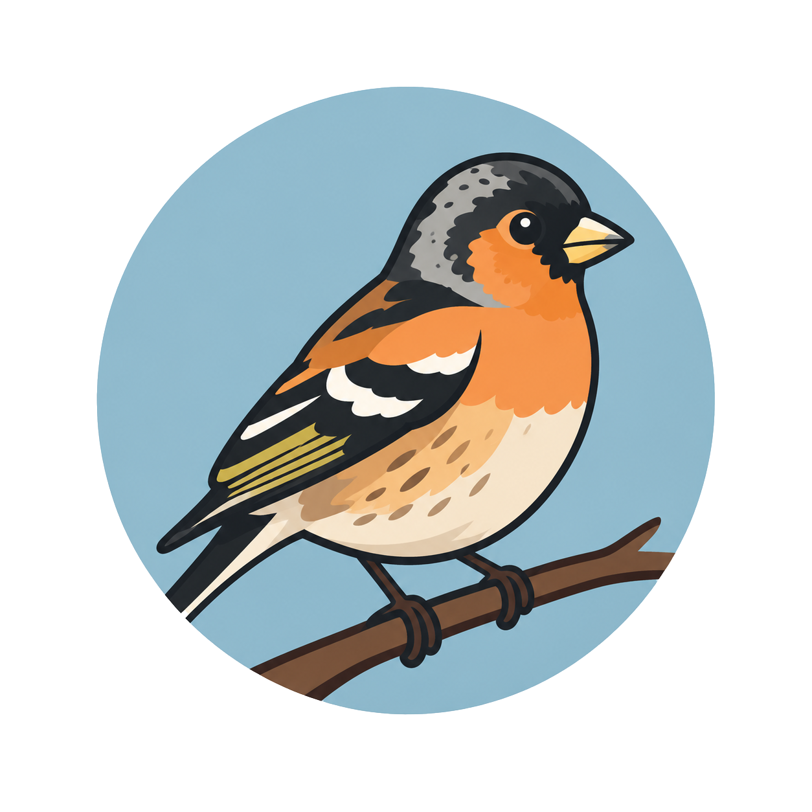

# Brambling

A self-hosted podcast proxy designed for retro and legacy media players like classic iPods or Zunes that are missing features like speedup or silence trimming.

Brambling automatically fetches your podcast feeds (both public and authenticated/private feeds with tokens) and processes every episode through **variable playback speed**, **silence trimming**, and **voice equalization**. It then republishes each show on your local network as a standard, universally compatible RSS feed containing MP3 files. 

Whatever syncing software or podcast client you already use simply subscribes to Brambling's generated feed instead of the original source.

> **How it fits into your workflow:**
> ```text
> Source Feeds ──► Brambling (Docker) ──► Podcast App / Sync Tool ──► Legacy Device
> (Public/Private)   │
>                    ├─ Refreshes every 30 minutes
>                    ├─ Downloads new episodes
>                    ├─ Applies FFmpeg processing (Speed · Trim Silence · Voice EQ → MP3)
>                    └─ Serves /feeds/<slug>.xml + /media/…
> ```
> 
> *Brambling is purely a proxy. Media syncing, playback state, and tracking remain entirely with your existing podcast app and device.*

---

## Key Features

- **Per-Show Audio Processing:** Configure playback speed ($1.0\times$–$3.0\times$), trim silent pauses, apply voice equalization, or toggle processing per show.
- **Flexible Episode Selection:** Choose to sync only the *newest $N$ episodes* or manually pick specific items from the back catalog (individual episodes, custom ranges like `#300–#310`, or complete archives).
- **Chronological Playback Order:** Option to serve episodes oldest-first, ensuring serialized shows play from the beginning even on legacy devices that sort strictly by release date.
- **Universal MP3 Output:** Generates MP3 files compatible with legacy hardware without degrading source quality (e.g., a 128 kbps source stream is maintained at 128 kbps).
- **Private Feed Security:** Feeds containing private API keys or tokens are stored securely on the server and masked in both logs and the web UI.
- **Storage & Scheduling Guards:** Automatically pauses downloads when available disk space is low, and allows heavy audio conversion tasks to be restricted to off-peak hours (e.g., overnight from `01:00–06:00`).

---

## Quick Start

Brambling is built from source using Docker Compose.

### Prerequisites
- Docker with Docker Compose installed on an always-on network machine (NAS, mini PC, or a Raspberry Pi 4/5 running a 64-bit OS).
- **Memory:** The initial build compiles Swift, requiring approximately **4 GB of RAM**.
- **Build Time:** Takes ~10 minutes on a 4-core mini PC; subsequent builds take only seconds unless code changes occur. Tested on `amd64` and `arm64`.

### Installation

1. **Clone the repository:**
   ```bash
   git clone https://github.com/Finch-Ing/Brambling.git
   cd Brambling
   ```

2. **Configure environment:**
   Open [`docker-compose.yml`](docker-compose.yml) and set at least `TZ` (your timezone) and `BRAMBLING_PUBLIC_BASE_URL`.

3. **Build and launch:**
   ```bash
   docker compose up -d --build
   ```

4. **Add your first show:**
   - Navigate to `http://<machine-ip>:8080/` in your browser.
   - Click **+**, paste a podcast feed URL, configure audio options, and save.
   - Click **Copy feed URL** on the show card.

5. **Subscribe:**
   Paste the copied URL into your primary podcast client (e.g., in Apple Podcasts on macOS: **File → Follow a Show by URL…**), then sync to your player as usual.

> **Tip:** Under **Settings → Processing Time**, verify the container's local time (controlled by the `TZ` variable) and set optional conversion schedules (e.g., overnight execution).

Data files (SQLite database, processed media, and artwork) are persisted in the `./data` directory relative to your Compose file. Back up this folder to retain your setup.

### Updating

To update Brambling, pull the latest changes and rebuild (your `./data` directory will remain intact):

```bash
git pull
docker compose up -d --build
```

---

## Network & Security Considerations

Brambling serves unencrypted HTTP traffic on port `8080` by default.

- **Internal Use Only:** Do **not** expose port `8080` directly to the open internet. Access Brambling via your local network (LAN) or a secure VPN (e.g., Tailscale or WireGuard).
- **Authentication:** Enable basic authentication using `BRAMBLING_USER` and `BRAMBLING_PASS` if you share your local network. Generated RSS feeds, media files, artwork, and `/health` endpoints remain public so podcast clients do not require basic auth headers.
- **Static IP Recommendation:** Generated feed URLs rely on the host address used during requests. Ensure your host machine uses a static IP or local DNS name.
- **Reverse Proxy / HTTPS:** If running behind a reverse proxy (Caddy, Traefik, Nginx), pass the `X-Forwarded-Proto` header. Brambling will automatically format feed and media links with HTTPS scheme URLs.

---

## Configuration Reference

All settings are configured via environment variables in [`docker-compose.yml`](docker-compose.yml).

| Variable | Default | Description |
| :--- | :--- | :--- |
| `TZ` | `UTC` | Timezone used for scheduling windows and the UI. |
| `PUID` / `PGID` | `1000` | User ID and Group ID for ownership of `./data` files. |
| `BRAMBLING_PUBLIC_BASE_URL` | `http://127.0.0.1:8080` | Fallback base URL for feed links when client headers are missing. |
| `BRAMBLING_REFRESH_MINUTES` | `30` | Interval (in minutes) between upstream feed refreshes. |
| `BRAMBLING_DOWNLOAD_CONCURRENCY` | `2` | Maximum number of concurrent episode downloads. |
| `BRAMBLING_FFMPEG_CONCURRENCY` | `1` | Concurrent FFmpeg audio processing tasks (1 CPU core per job). |
| `BRAMBLING_MIN_FREE_GB` | `5` | Minimum free disk space threshold (GB) before pausing tasks. |
| `BRAMBLING_MAX_MEDIA_GB` | *None* | Optional total storage limit (GB) for cached media and temporary files. |
| `BRAMBLING_PROCESS_WINDOW` | *None* | Restrict FFmpeg execution to a time range (e.g., `01:00-06:00`). Overridden if modified in the UI. |
| `BRAMBLING_USER` / `BRAMBLING_PASS` | *None* | Basic Auth credentials for securing the Web UI and administrative API. |
| `LOG_LEVEL` | `info` | Logging verbosity: `debug`, `info`, `warning`, or `error`. |

---

## Endpoints

| Endpoint | Description |
| :--- | :--- |
| `GET /feeds/<slug>.xml` | Generated RSS feed for processed episodes. |
| `GET /media/<slug>/<file>.mp3` | Processed audio file (supports HTTP Range requests for streaming/seeking). |
| `GET /art/<slug>.jpg` | Processed show artwork ($1400 \times 1400$). |
| `GET /health` | Service status check endpoint. |

*Note: Administrative REST endpoints are available under `/api/shows` and `/api/queue` (protected by Basic Auth if enabled).*

---

## Local Development

To run and test Brambling outside of Docker, ensure you have **Swift 6** and **FFmpeg** installed locally:

```bash
# Run unit tests
swift test

# Start local server instance
BRAMBLING_DATA=./data swift run Brambling serve
```

---

## Acceptable Use Policy

Brambling is intended strictly for personal media management. Ensure you only process feeds you have legal authorization to access. Please do not share or redistribute the generated feeds or processed files of paid or private subscriber feeds.
